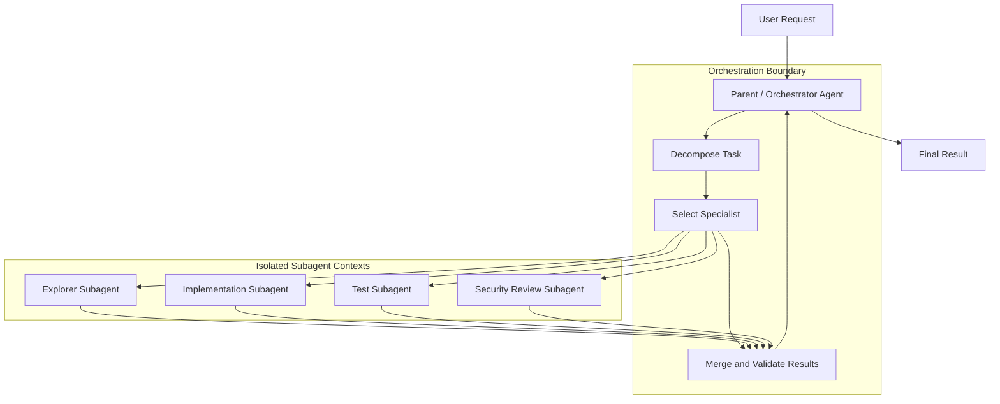
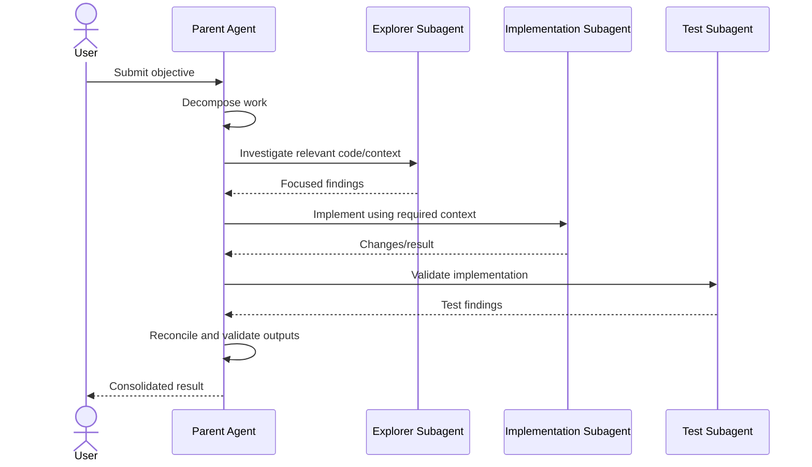
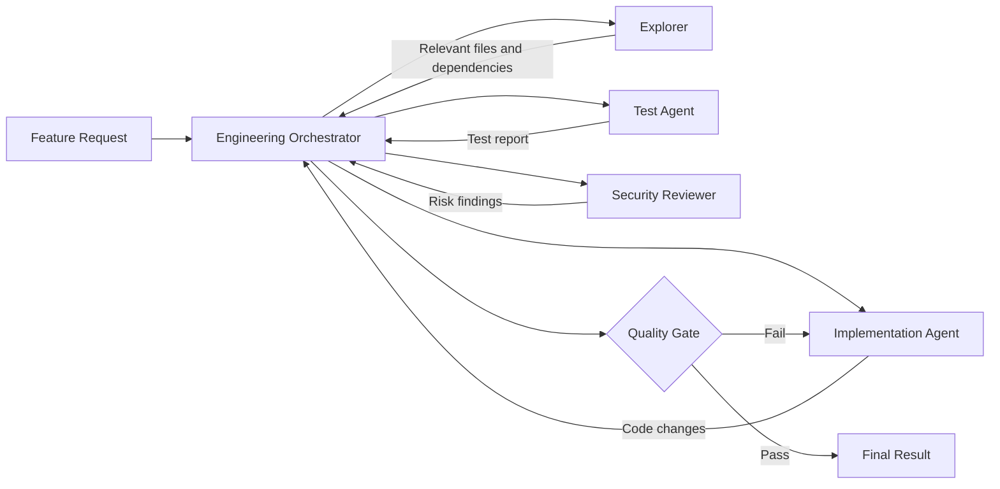

# Introduction to Subagents

> **Source course:** https://anthropic-partners.skilljar.com/introduction-to-subagents/450700
>
> **Content note:** The authenticated Skilljar lesson itself was not retrievable from the supplied URL. This file is therefore a concise architecture-oriented study template based on the course topic, rather than a verbatim or complete extraction of the restricted lesson.

## 1. What is a Subagent?

### Summary
A **subagent** is a specialized agent delegated a focused task by a parent or orchestrating agent. The architectural goal is separation of responsibility: the parent coordinates the overall objective while individual subagents concentrate on narrower areas such as exploration, implementation, testing, security review, or documentation.

### Main Points
- Delegate bounded work instead of placing every task in one agent context.
- Give each subagent a clear role and expected result.
- Keep the parent agent responsible for orchestration and final integration.
- Use specialization when it provides better context isolation or task focus.

## 2. Why Use Subagents?

### Context Isolation
A specialized worker can operate with a focused context instead of continuously enlarging the parent agent's working context.

### Specialization
A subagent can be configured for a distinct responsibility, for example:
- code exploration
- implementation
- testing
- security review
- architecture analysis
- documentation

### Parallelizable Work
Independent investigations can potentially be delegated independently, while dependent steps should remain sequenced.

### Separation of Concerns
Subagent boundaries can mirror engineering responsibilities and make complex workflows easier to reason about.

## 3. Orchestrator and Subagent Architecture



## 4. Delegation Pattern



## 5. Designing a Good Subagent

### Give It One Clear Responsibility
Prefer a narrow role such as **security reviewer** over a vague role such as **general helper**.

### Define Inputs and Outputs
Specify:
- what problem the subagent receives
- which context it needs
- which tools it may use
- what output format it should return
- what constitutes completion

### Limit Tool Access
Provide only the capabilities required for the delegated responsibility. A read-only review agent generally should not need deployment or destructive write permissions.

### Keep Delegation Bounded
The parent should define the task boundary and remain responsible for integrating outputs into the larger objective.

## 6. Security Boundaries

```mermaid
flowchart LR
    subgraph T1[Trust Boundary 1: Parent Agent]
        P[Parent Agent]
        POL[Delegation Policy]
        P --> POL
    end

    subgraph T2[Trust Boundary 2: Subagent]
        S[Specialized Subagent]
        VAL[Input / Output Validation]
        VAL --> S
    end

    subgraph T3[Trust Boundary 3: Tools]
        T1[Read-only Tools]
        T2[Write Tools]
        T3[External Services]
    end

    POL -->|Scoped task + minimum context| VAL
    S -->|Allowed| T1
    S -->|Approval / authorization| T2
    S -->|Authenticated request| T3
    S -->|Structured result| P
```

### Important Controls
- Apply least privilege to subagent tools.
- Do not transfer secrets simply because a child task was delegated.
- Treat retrieved or external content as untrusted.
- Validate results before the parent uses them for consequential actions.
- Require explicit authorization or approval for sensitive side effects.
- Log important delegated actions for auditability.

## 7. Choosing Between One Agent and Subagents

| Situation | Preferred Pattern | Why |
|---|---|---|
| Small, tightly scoped task | Single agent | Delegation overhead adds little value |
| Large repository investigation | Explorer subagent | Keeps discovery work focused |
| Implementation plus independent review | Multiple roles | Separates creation from validation |
| Security-sensitive review | Dedicated security subagent | Allows specialized instructions and restricted tools |
| Several independent investigations | Parallel subagents where supported | Reduces coupling between separate workstreams |
| Strong step-to-step dependencies | Sequential delegation | Later agents require earlier results |

## 8. Common Failure Modes

### Over-delegation
Creating subagents for trivial tasks increases coordination overhead.

### Vague Responsibilities
Overlapping roles can produce duplicated or contradictory work.

### Excessive Context Passing
Sending the complete parent context to every subagent weakens one of the main architectural advantages of delegation.

### Excessive Permissions
A specialized worker should not automatically inherit every powerful capability available to the parent.

### Missing Result Validation
The parent should not assume that a subagent result is automatically correct, safe, or complete.

## 9. Example: Software Engineering Workflow



For an architecture like **FastAPI + MCP + Neo4j**, possible specializations are:
- **API agent:** FastAPI endpoints and schemas
- **Graph agent:** Neo4j model and Cypher review
- **MCP agent:** tool definitions, schemas, and protocol integration
- **Security agent:** authentication, authorization, prompt injection, and tool-boundary review
- **Test agent:** API, graph, and integration validation

## 10. Architecture Takeaways

1. **Subagents are an architectural decomposition mechanism.** Use them to divide work along meaningful responsibility boundaries.
2. **Isolation is valuable.** Give each subagent only the context needed for its task.
3. **Specialize deliberately.** Scope roles, instructions, tools, and output contracts to the delegated job.
4. **The parent remains accountable for orchestration.** Delegation should not eliminate validation or integration logic.
5. **Permissions should follow least privilege.** A subagent's capability boundary should match its responsibility.
6. **Use multiple agents only when the benefit outweighs coordination cost.** Small tasks are often simpler with a single agent.

## 11. Quick Reference

| Topic | Key Idea | Architecture Impact |
|---|---|---|
| Delegation | Parent assigns a bounded objective | Enables decomposition |
| Isolation | Worker operates in focused context | Reduces unrelated context |
| Specialization | Worker has task-specific instructions | Improves role clarity |
| Tool scope | Worker receives required capabilities | Supports least privilege |
| Orchestration | Parent coordinates workers | Centralizes workflow control |
| Validation | Outputs are reviewed/integrated | Improves reliability and safety |
| Parallelism | Independent tasks may run separately | Can shorten suitable workflows |

## 12. Questions to Capture from the Course

Use these fields when reviewing the authenticated lesson so the notes can be made course-faithful:

- Exact definition of a subagent
- Built-in versus custom subagent types discussed
- How subagents are created/configured
- Tool inheritance or restriction behavior
- Context isolation behavior
- Delegation and selection behavior
- Parallel versus sequential execution guidance
- Persistence or scope of subagent definitions
- Recommended use cases
- Limitations and anti-patterns
- Security or permission guidance
- Course demonstrations and code/configuration examples

## Source

- [Introduction to Subagents](https://anthropic-partners.skilljar.com/introduction-to-subagents/450700)
